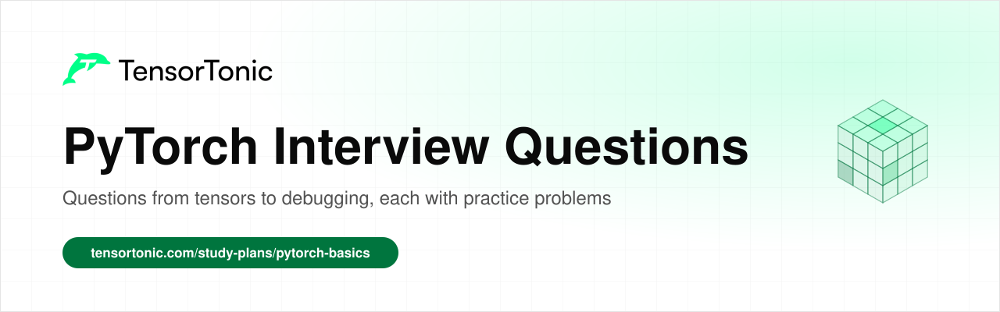
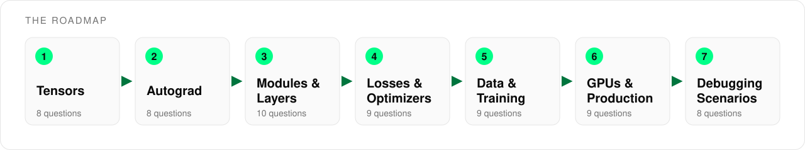

# PyTorch Interview Questions

  

This is a list of the PyTorch questions that come up in ML engineer and research interviews, grouped in the order you would learn them. It covers 61 questions across seven stages, from tensors and autograd to distributed training and debugging a broken run.

Every question links to an explanation where one exists and to practice problems where you implement the idea yourself and check your code against tests. Interviewers rarely stop at the definition, and writing the code is the fastest way to be ready for the follow-up question.

## Table of Contents

- [Who this is for](#who-this-is-for)
- [How to use this roadmap](#how-to-use-this-roadmap)
- [Stage 1: Tensors](#stage-1-tensors)
- [Stage 2: Autograd](#stage-2-autograd)
- [Stage 3: Modules and Layers](#stage-3-modules-and-layers)
- [Stage 4: Losses and Optimizers](#stage-4-losses-and-optimizers)
- [Stage 5: Data and the Training Loop](#stage-5-data-and-the-training-loop)
- [Stage 6: GPUs and Production](#stage-6-gpus-and-production)
- [Stage 7: Debugging Scenarios](#stage-7-debugging-scenarios)
- [What's next](#whats-next)

## Who this is for

This list is for anyone who has a PyTorch interview coming up and wants to know what will be asked.

- If you are a **student**, work through the stages in order and solve at least one problem per question.
- If you are **switching into ML engineering**, stages 4 to 7 cover the training and debugging questions that separate users of a library from people who can run it in production.
- If you already **use PyTorch at work**, treat the tables as a checklist and stop on any question you cannot answer out loud in a minute.

You need working Python and a basic idea of what a neural network is. You do not need to have trained a large model before.

## How to use this roadmap

The stages build on each other. Autograd only makes sense once tensors and their shapes are clear, and the debugging stage at the end assumes you know everything before it.

For each question, try to answer it out loud first, then read the linked explanation and solve the practice problem. Some questions have no practice link because they are about PyTorch behaviour that is better learned by reading the explanation and trying it in your own code.

## Stage 1: Tensors

Almost every PyTorch bug starts with a tensor that has the wrong shape, dtype or memory layout. Interviewers use these questions to check that you understand what a tensor is underneath the API, including storage, strides and when an operation copies data.

| Question | Read | Practice |
| --- | --- | --- |
| How is a PyTorch tensor different from a NumPy array, and when do they share memory? | [PyTorch study plan](https://www.tensortonic.com/study-plans/pytorch-basics) | [Tensor Factory](https://www.tensortonic.com/problems/pytorch-tensor-creation) |
| What are strides, and why does view fail after a transpose? | | [Matrix Transpose](https://www.tensortonic.com/problems/matrix-transpose) |
| When should you use view, reshape or contiguous? | | [Tensor Shape Manipulation](https://www.tensortonic.com/problems/pytorch-tensor-reshape) |
| How does broadcasting work, and what goes wrong when you subtract a tensor of shape (N,) from one of shape (N, 1)? | | [Tensor Operations](https://www.tensortonic.com/problems/pytorch-tensor-arithmetic) |
| What is the difference between basic indexing, fancy indexing and boolean masks? | | [Fancy Indexing](https://www.tensortonic.com/problems/numpy-fancy-indexing), [Boolean Masking](https://www.tensortonic.com/problems/numpy-boolean-masking) |
| What do gather and scatter do? | | [One-Hot Encoding (Multi-class)](https://www.tensortonic.com/problems/one-hot-encoding) |
| When would you use einsum instead of matmul or bmm? | [What is matrix multiplication?](https://www.tensortonic.com/ml-math/linear-algebra/matrix-multiplication) | [Named-Dimension Batched Attention Scores](https://www.tensortonic.com/problems/cs336-l02-einsum-attention-scores) |
| When are in-place operations dangerous? | | [Mutation Trap](https://www.tensortonic.com/problems/numpy-mutation-trap) |

## Stage 2: Autograd

Autograd is the part of PyTorch that interviewers probe hardest, because it is easy to use without understanding. If you can explain how the graph is recorded and walked backwards, most of the training loop questions later become easy.

| Question | Read | Practice |
| --- | --- | --- |
| How does autograd record operations and compute gradients? | [What is a computational graph?](https://www.tensortonic.com/ml-math/graph-theory/computational-graphs), [Build Micrograd from Scratch](https://www.tensortonic.com/study-plans/autograd-from-scratch) | [Build a Scalar Expression Graph](https://www.tensortonic.com/problems/autograd-l02-build-expression-graph), [Run Reverse-Mode Autodiff](https://www.tensortonic.com/problems/autograd-l05-reverse-mode-autodiff) |
| What is a leaf tensor, and why do intermediate tensors have no gradient after backward? | | [Basic Autograd](https://www.tensortonic.com/problems/pytorch-basic-autograd), [Trace a Reachable Expression Graph](https://www.tensortonic.com/problems/autograd-l02-trace-reachable-graph) |
| Why do gradients accumulate, and why do you call zero_grad before each backward pass? | [Gradient accumulation](https://www.tensortonic.com/llm-internals/gradient-accumulation) | [Accumulate Shared-Path Gradients](https://www.tensortonic.com/problems/autograd-l06-shared-path-gradient-accumulation) |
| What is the difference between torch.no_grad, torch.inference_mode and detach? | | |
| Why does calling backward twice on the same graph raise an error? | [How backpropagation works](https://www.tensortonic.com/ml-math/calculus/backpropagation) | |
| How do you call backward on an output that is not a scalar? | [Jacobian and Hessian matrices](https://www.tensortonic.com/ml-math/calculus/jacobian-hessian) | [Apply Local Vector-Jacobian Rules](https://www.tensortonic.com/problems/autograd-l05-local-vjp-rules) |
| How do you write a custom autograd Function with its own backward? | [What is the chain rule?](https://www.tensortonic.com/ml-math/calculus/chain-rule) | [Differentiate a Tanh Activation](https://www.tensortonic.com/problems/autograd-l04-tanh-forward-backward), [Differentiate Exponentials and Powers](https://www.tensortonic.com/problems/autograd-l06-exp-power-backward) |
| How do you check that your gradients are correct? | | [Gradient-Check an Autodiff Graph](https://www.tensortonic.com/problems/autograd-l05-autodiff-gradient-check), [Gradient-Check a Scalar Neuron](https://www.tensortonic.com/problems/autograd-l04-neuron-gradient-check) |

## Stage 3: Modules and Layers

Interviewers expect you to write a custom module from memory and to state the input and output shapes of the common layers without looking them up. These questions also cover how modules register parameters and why train and eval mode give different results.

| Question | Read | Practice |
| --- | --- | --- |
| How do you write a minimal custom nn.Module, and why call model(x) instead of model.forward(x)? | | [Custom Linear Layer](https://www.tensortonic.com/problems/pytorch-custom-linear-layer), [Build a Scalar Neuron Module](https://www.tensortonic.com/problems/autograd-l07-scalar-neuron-module) |
| What is the difference between an nn.Parameter and a buffer? | | [Collect Module Parameters Recursively](https://www.tensortonic.com/problems/autograd-l07-recursive-parameter-collection) |
| Why should layers live in an nn.ModuleList instead of a plain Python list? | | [Evaluate a Multi-Layer Perceptron](https://www.tensortonic.com/problems/autograd-l07-mlp-forward) |
| What do model.train() and model.eval() change? | [What is batch norm?](https://www.tensortonic.com/ml-math/optimization/batch-normalization) | [Dropout (Training Mode)](https://www.tensortonic.com/problems/dropout-training) |
| How are weights initialised by default, and how do you change it? | | [Xavier Initialization](https://www.tensortonic.com/problems/xavier-initialization), [Weight Initialization](https://www.tensortonic.com/problems/pytorch-weight-initialization) |
| How do you freeze part of a model for fine-tuning? | [Reusing pretrained models](https://www.tensortonic.com/ml-design/pretrained-models) | |
| What input shapes do nn.Linear, nn.Conv2d and nn.LSTM expect? | | [2D Convolution (Image Filtering)](https://www.tensortonic.com/problems/conv2d-image-filtering), [LSTM Cell from Scratch](https://www.tensortonic.com/problems/pytorch-lstm-cell-from-scratch) |
| What is the difference between BatchNorm and LayerNorm? | [Layer normalization in the Transformer](https://www.tensortonic.com/research/transformer/transformers-layer-normalization) | [Batch Normalization (Forward)](https://www.tensortonic.com/problems/batch-normalization), [Layer Normalization](https://www.tensortonic.com/problems/dl-layer-normalization) |
| How do you implement causal self-attention, and how do the multi-head reshapes work? | [Attention in LLMs](https://www.tensortonic.com/llm-internals/attention-mechanism), [Multi-head attention](https://www.tensortonic.com/research/transformer/transformers-multi-head-attention) | [Causal Masking for Attention](https://www.tensortonic.com/problems/causal-masking), [Multi-Head Attention](https://www.tensortonic.com/problems/pytorch-multi-head-attention) |
| How would you write a residual block? | [ResNet skip connections](https://www.tensortonic.com/research/resnet/resnet-skip-connection) | [Residual Block](https://www.tensortonic.com/problems/pytorch-residual-block) |

## Stage 4: Losses and Optimizers

Picking the wrong loss or passing it the wrong input is one of the most common silent bugs, so interviewers check that you know exactly what each loss expects. The optimizer questions test whether you understand what happens inside a single update step.

| Question | Read | Practice |
| --- | --- | --- |
| What does nn.CrossEntropyLoss expect as its input and target? | [What is cross-entropy?](https://www.tensortonic.com/ml-math/information-theory/cross-entropy) | [Cross-Entropy Loss](https://www.tensortonic.com/problems/cross-entropy-loss), [Loss Functions](https://www.tensortonic.com/problems/pytorch-loss-functions) |
| When do you use BCEWithLogitsLoss instead of BCELoss? | [Which loss function to use](https://www.tensortonic.com/guides/which-loss-function-to-use) | [Binary Log Loss per Sample](https://www.tensortonic.com/problems/log-loss-per-sample) |
| How do you write a numerically stable softmax and log-softmax? | | [Numerically Stable Softmax](https://www.tensortonic.com/problems/softmax-function), [Softmax from Scratch](https://www.tensortonic.com/problems/pytorch-softmax-from-scratch) |
| How do you mask padding tokens out of a sequence loss? | | [Build an Assistant-Only SFT Loss Mask](https://www.tensortonic.com/problems/cs336-l15-assistant-only-sft-mask) |
| How do you handle class imbalance in the loss? | [Rare events and class imbalance](https://www.tensortonic.com/ml-design/sampling) | [Focal Loss](https://www.tensortonic.com/problems/focal-loss) |
| What is the difference between SGD with momentum, Adam and AdamW? | [Which optimizer to use](https://www.tensortonic.com/guides/which-optimizer-to-use), [Adam vs RMSprop vs AdaGrad](https://www.tensortonic.com/ml-math/optimization/adaptive-rates) | [Adam Optimizer Step](https://www.tensortonic.com/problems/adam-optimizer), [AdamW (Decoupled Weight Decay)](https://www.tensortonic.com/problems/adamw-optimizer) |
| How would you implement SGD with momentum as a custom optimizer? | [Momentum and Nesterov](https://www.tensortonic.com/ml-math/optimization/momentum-nesterov) | [Custom SGD with Momentum](https://www.tensortonic.com/problems/pytorch-custom-optimizer) |
| In what order do you call optimizer.step and scheduler.step, and why use warmup with cosine decay? | | [Cosine Annealing LR Scheduler](https://www.tensortonic.com/problems/cosine-annealing-lr), [Optimizer Scheduler](https://www.tensortonic.com/problems/pytorch-optimizer-scheduler) |
| Where does gradient clipping go in the training step? | | [Gradient Clipping (Global Norm)](https://www.tensortonic.com/problems/gradient-clipping) |

## Stage 5: Data and the Training Loop

Most coding rounds end with writing a full training loop, and most take-home bugs live in the data pipeline. This stage covers loading and splitting data correctly and the parts of the loop people forget under time pressure.

| Question | Read | Practice |
| --- | --- | --- |
| What is the difference between a Dataset and a DataLoader? | | [Custom Dataset Class](https://www.tensortonic.com/problems/pytorch-custom-dataclass), [Batch Shuffling & Mini-Batch Generator](https://www.tensortonic.com/problems/batch-generator) |
| What is collate_fn, and when do you need a custom one? | | [Pad Sequences](https://www.tensortonic.com/problems/pad-sequences) |
| What do num_workers and pin_memory do? | | |
| How do you balance an imbalanced dataset in the loader? | | [Balanced DataLoader](https://www.tensortonic.com/problems/pytorch-balanced-dataloader) |
| How do you split data into train, validation and test sets without leakage? | [Data splits and leakage](https://www.tensortonic.com/ml-design/leakage) | [Stratified Train/Test Split](https://www.tensortonic.com/problems/stratified-split), [K-Fold Split (Indices Only)](https://www.tensortonic.com/problems/kfold-split) |
| What does a complete training and validation loop look like? | | [Apply One Full SGD Training Step](https://www.tensortonic.com/problems/autograd-l08-sgd-training-step), [Mini Training Loop](https://www.tensortonic.com/problems/pytorch-mini-training) |
| How do you implement gradient accumulation, and how should the loss be scaled? | [Gradient accumulation](https://www.tensortonic.com/llm-internals/gradient-accumulation) | [Gradient Accumulation Equivalence](https://www.tensortonic.com/problems/cs336-l02-gradient-accumulation-step), [Gradient Accumulation](https://www.tensortonic.com/problems/pytorch-gradient-accumulation) |
| How do you implement early stopping? | | [Early Stopping](https://www.tensortonic.com/problems/pytorch-early-stopping) |
| What should a checkpoint contain so training can resume? | [Training pipelines and versioning](https://www.tensortonic.com/ml-design/training) | |

## Stage 6: GPUs and Production

Senior and ML infrastructure interviews move quickly from the training loop to memory, speed and scale. These questions cover what limits a GPU, how training is split across devices, and how a model is saved, compressed and rolled out.

| Question | Read | Practice |
| --- | --- | --- |
| How much GPU memory does training a model take, and how do you debug an out-of-memory error? | | [Mixed-Precision Training Memory Accountant](https://www.tensortonic.com/problems/cs336-l02-training-memory-accountant) |
| How do you use automatic mixed precision, and when do you need a gradient scaler? | [Mixed precision training](https://www.tensortonic.com/llm-internals/mixed-precision) | |
| Why is a GPU often memory-bound rather than compute-bound? | [FlashAttention explained](https://www.tensortonic.com/llm-internals/flash-attention) | [Global-Memory Coalescing Counter](https://www.tensortonic.com/problems/cs336-l05-global-memory-coalescing) |
| What does torch.compile do, and where does the speedup come from? | | [Fused Tiled Matmul and ReLU](https://www.tensortonic.com/problems/cs336-l06-triton-matmul-relu) |
| What is the difference between DataParallel and DistributedDataParallel? | | [Synchronize Data-Parallel Gradients](https://www.tensortonic.com/problems/cs336-l07-data-parallel-gradient-sync) |
| What is FSDP, and when do you need it instead of DDP? | | [Account for ZeRO Memory by Stage](https://www.tensortonic.com/problems/cs336-l08-zero-memory-accounting) |
| How should you save and load a model, and where does the module. prefix in a state_dict come from? | | |
| What kinds of quantization does PyTorch support? | [LLM quantization explained](https://www.tensortonic.com/llm-internals/quantization) | [Symmetric INT8 Quantization](https://www.tensortonic.com/problems/inference-symmetric-int8-quantization), [Per-Channel Weight Quantization](https://www.tensortonic.com/problems/inference-per-channel-quantization) |
| How do you roll out a new model version safely? | [A/B testing and safe rollout](https://www.tensortonic.com/ml-design/experiments) | [Model Versioning](https://www.tensortonic.com/problems/model-versioning-basics), [Shadow Deployment Evaluation](https://www.tensortonic.com/problems/shadow-deployment-evaluation) |

## Stage 7: Debugging Scenarios

Many interviews include a scenario where a training run is broken and you have to talk through how you would find the cause. Good answers name the likely causes in order and the check that rules each one out.

| Question | Read | Practice |
| --- | --- | --- |
| The loss is not decreasing at all. Where do you look first? | [Training loss not decreasing](https://www.tensortonic.com/guides/training-loss-not-decreasing) | [Train a Tiny Micrograd MLP](https://www.tensortonic.com/problems/autograd-l08-train-tiny-micrograd-mlp) |
| The loss becomes NaN after a few hundred steps. What do you check? | | [Warmup + Linear Decay LR Schedule](https://www.tensortonic.com/problems/warmup-decay-lr), [Learning Rate Warmup Scheduler](https://www.tensortonic.com/problems/pytorch-lr-warmup-scheduler) |
| Validation accuracy is far worse than training accuracy, even when you evaluate on the training data. What is wrong? | | [Batch Normalization](https://www.tensortonic.com/problems/pytorch-batch-normalization) |
| GPU memory grows every iteration until it runs out. What is holding on to it? | | |
| GPU utilisation is low and training is slow. How do you find the bottleneck? | | [Measure Kernel Timeline Utilization](https://www.tensortonic.com/problems/cs336-l18-kernel-timeline-utilization) |
| You get an error that mat1 and mat2 shapes cannot be multiplied. How do you track it down? | | [Evaluate a Dense Layer](https://www.tensortonic.com/problems/autograd-l07-dense-layer-forward) |
| Fine-tuning made the pretrained model worse than before. What went wrong? | [Reusing pretrained models](https://www.tensortonic.com/ml-design/pretrained-models) | |
| The loss goes down, but the model predicts the same class for every input. Why? | | [Binary Focal Loss](https://www.tensortonic.com/problems/binary-focal-loss) |

## What's next

Once you can answer these questions, practise writing the code under time pressure. The [PyTorch study plan](https://www.tensortonic.com/study-plans/pytorch-basics) and [Cracking Deep Learning](https://www.tensortonic.com/study-plans/cracking-dl) cover the coding round, the [ML coding interview questions](https://www.tensortonic.com/guides/ml-coding-interview-questions) guide lists the functions most often asked from scratch, and the [MLE mock interview](https://www.tensortonic.com/assessments/mle-mock-interview) lets you test yourself before the real one.

To see these PyTorch pieces work together in one model, the [How to Build an LLM from Scratch](https://www.tensortonic.com/guides/build-an-llm-from-scratch) guide walks through writing a small language model stage by stage and explains when to use NumPy or PyTorch for it.

If you are still learning the library itself, the [How to Learn PyTorch](https://www.tensortonic.com/guides/how-to-learn-pytorch) guide explains how to learn it step by step, and the [Deep Learning Interview Questions](https://www.tensortonic.com/guides/deep-learning-interview-questions) guide covers the theory questions that are often asked alongside the PyTorch round.

For a written walkthrough of how to prepare, the [PyTorch Interview Questions](https://www.tensortonic.com/guides/pytorch-interview-questions) guide explains how to answer the PyTorch questions interviewers ask most often, and the [NumPy Interview Questions](https://www.tensortonic.com/guides/numpy-interview-questions) guide covers the array questions that often come up in the same round.

## License

MIT
